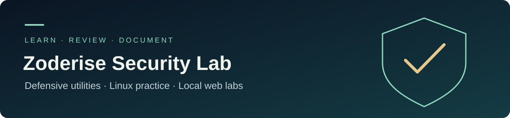
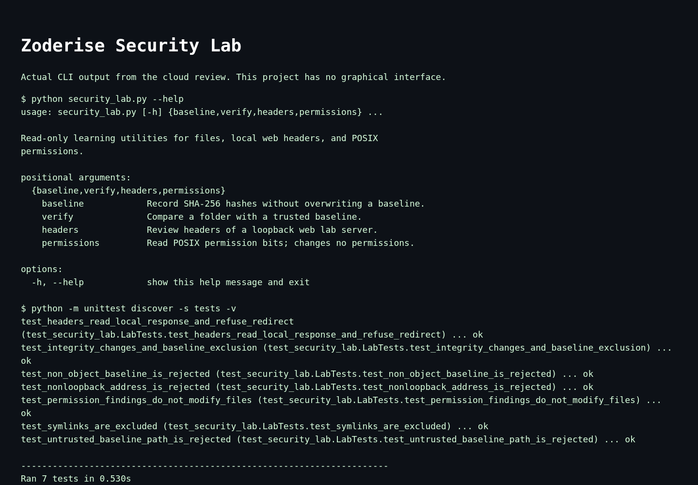

<div align="center">
  
</div>

# Zoderise Security Lab

An inspectable Python toolkit for learning defensive security through repeatable local experiments. It records file hashes, reviews selected HTTP response headers on a loopback server, and reports POSIX permission bits that deserve attention.

Created by **Zubair Zahidi** as a practical starting point for a cybersecurity and ethical-hacking learning portfolio.

## Included utilities

| Command | What it does | Limit |
| --- | --- | --- |
| `baseline` | Records SHA-256 hashes of a chosen folder. | Does not overwrite an existing baseline. |
| `verify` | Reports added, removed, and modified files. | A baseline is trustworthy only when protected separately. |
| `headers` | Reviews CSP, nosniff, referrer policy, frame policy, and HTTPS HSTS presence. | Accepts only localhost or loopback IPs; follows no redirects. |
| `permissions` | Reports world-writable paths, with optional group-write review. | POSIX systems only; does not inspect Windows ACLs or change permissions. |

## Quick start

Install Python 3.10 or newer. The utilities use the standard library and need no extra packages.

```bash
git clone https://github.com/Zubair-zahidi/zoderise-security-lab.git
cd zoderise-security-lab
python security_lab.py --help
```

Record and compare files in your own lab folder:

```bash
python security_lab.py baseline ./lab-files --output ./baseline.json
python security_lab.py verify ./lab-files --baseline ./baseline.json
```

Review a local server that you started:

```bash
python security_lab.py headers http://127.0.0.1:8000/
```

On Linux or another POSIX environment:

```bash
python security_lab.py permissions ./lab-files
```

Output is JSON. Exit codes are `0` for successful completion, `1` when integrity comparison finds differences, and `2` for an error. The header review deliberately provides no vulnerability score.

## Learn by doing

- [Guided local exercises](docs/LABS.md)
- [Linux and security learning toolkit](docs/TOOLKIT.md)
- [Finding and remediation report template](docs/REPORT_TEMPLATE.md)

## Verification

```bash
python -m unittest discover -s tests -v
```

Tests exercise integrity changes, unsafe baseline paths, loopback header inspection, redirect refusal, and external-address rejection. POSIX permission and symlink checks run on compatible platforms; Windows skips those two tests. GitHub Actions runs the suite on Windows and Linux.

## Scope

Use the toolkit on your own files and authorized lab systems. These utilities are learning aids, not a penetration-test report, malware detector, compliance certification, or complete security audit. Files can change while hashing; use a quiet folder for a stable comparison. Symbolic links and common Git/virtual-environment cache directories are excluded. Reviews stop at 10,000 paths to keep lab runs bounded.

Never commit credentials, packet captures containing private traffic, or real customer data. Keep reports in protected storage and remove identifying details before sharing a learning write-up.

## Cloud review preview



Captured from the running project on 22 October 2026. This is a browser rendering of actual CLI output and test results. The project has no graphical application.
